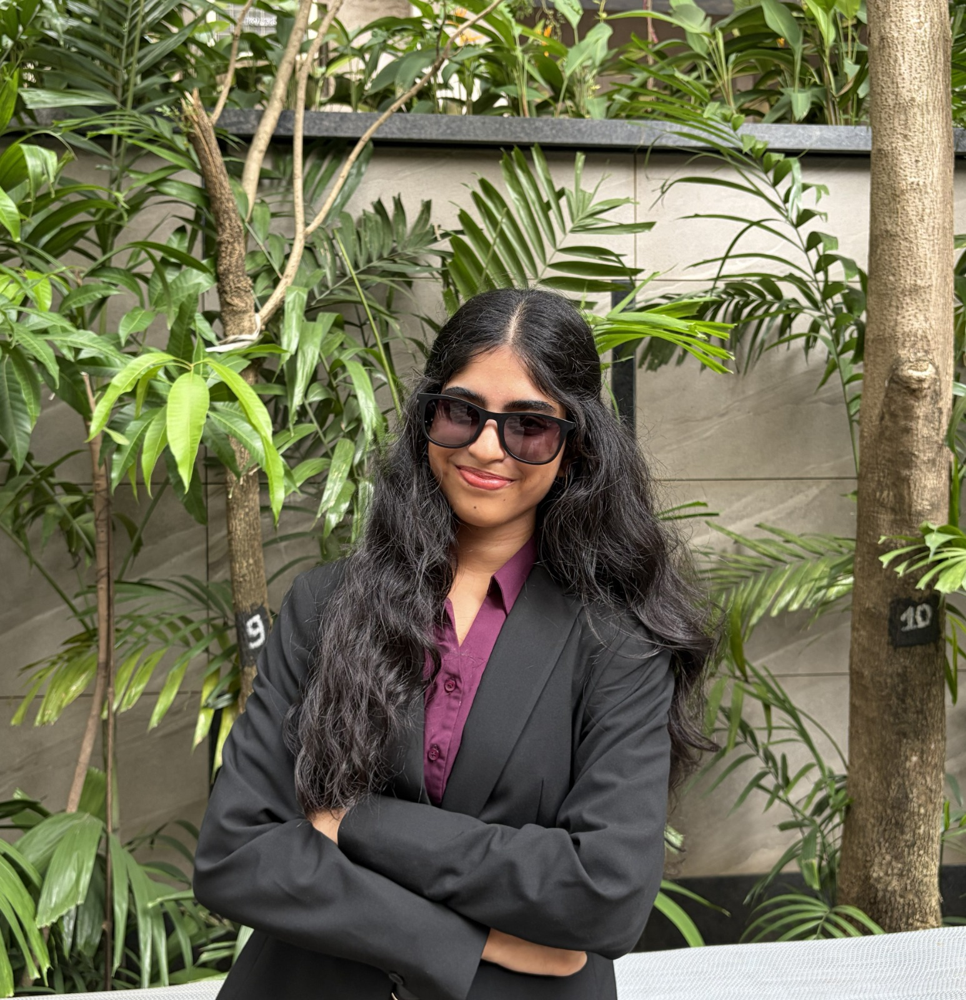

<p align="center">
  <a href="https://github.com/Hawtspecta">
    
  </a>
  
</p>

<p align="center">
  <a href="https://www.linkedin.com/in/sahana-santosh-nayak"></a>
  <a href="https://portfolio-sahana.vercel.app"></a>
  <a href="mailto:nayaksahana0307@gmail.com"></a>
</p>

<p align="center">
  
  
  
</p>

## 🧬 about



```python
me = {
    "does": "building production AI/ML architectures & expressive web applications",
    "based": "Mumbai, India",
    "was": "AI/ML Intern @ InVizn",
    "degree": "B.Tech in Artificial Intelligence & Machine Learning, DJSCE",
    "learning": "Multimodal Agentic Workflows, Distributed RAG & WebGL",
    "speaks": ["English", "Hindi", "Marathi", "Konkani", "Python"],
    "pronouns": "she/her",
}
```

<div style="clear: both;"></div>

<details>
<summary><b>🌱 how I got here. click for the short version</b></summary>
<br />
<table>
<tr><td><b>2010 – 2022</b></td><td>Completed Secondary School Certificate (SSC) with <b>94.00%</b> at Dr. Sarvepalli Radhakrishnan Vidyalaya</td></tr>
<tr><td><b>2022 – 2024</b></td><td>Higher Secondary Certificate (HSC) in Computer Science with <b>92.33%</b> at Patkar-Varde College</td></tr>
<tr><td><b>2024 – 2028</b></td><td>B.Tech in AI & ML with FinTech Minor at Dwarkadas J. Sanghvi College of Engineering (<b>9.5 Current CGPA</b>)</td></tr>
<tr><td><b>2026</b></td><td>AI/ML Intern at InVizn · Finalist at JPMorgan Chase Code For Good 2026 · 3rd Place at CodeQuest</td></tr>
</table>
</details>

## 💼 experience

<table>
<tr>
<td width="36%" valign="top"><b>AI/ML Intern</b><br /><sub>InVizn, Mumbai · Jun 2026 to Aug 2026</sub></td>
<td valign="top">Engineered multimodal RAG pipelines, context-aware chatbot systems, cloud-driven image-to-video generation workflows, and internal CRM/analytics dashboards.</td>
</tr>
<tr>
<td width="36%" valign="top"><b>Web Developer</b><br /><sub>Freelance · Apr 2026 to Oct 2026</sub></td>
<td valign="top">Delivered two end-to-end production client web apps (Myriad Arts & Glamator), translating Figma design systems into performant, responsive React architectures.</td>
</tr>
</table>

## 🚀 projects

<table>
<tr>
<td width="50%" valign="top">
<h3>⚖️ <a href="https://ai-law-bot-nu.vercel.app/">AI Law Bot</a></h3>
<sub><b>citation-backed legal assistant · live demo</b></sub>
<p>AI-driven legal companion providing statutory RAG semantic search, contract risk evaluation, and multi-document redline comparisons.</p>
<p><code>React</code> <code>TypeScript</code> <code>FastAPI</code> <code>Vector Search</code> <code>RAG</code></p>
<a href="https://ai-law-bot-nu.vercel.app/"></a>
</td>
<td width="50%" valign="top">
<h3>📊 <a href="https://ufi-omega.vercel.app/">Aadhaar Update Friction Index (UFI)</a></h3>
<sub><b>UIDAI Hackathon 2026 · live demo</b></sub>
<p>Reframes identity update telemetry into a 5-component behavioral friction sensor uncovering socioeconomic mobility and administrative bottlenecks.</p>
<p><code>Python</code> <code>Statistical Modeling</code> <code>Data Analytics</code></p>
<a href="https://ufi-omega.vercel.app/"></a>
</td>
</tr>
<tr>
<td width="50%" valign="top">
<h3>📄 <a href="https://ai-resume-analyzer-dun-one.vercel.app/">AI Resume Analyzer</a></h3>
<sub><b>intelligent ATS scoring · live demo</b></sub>
<p>End-to-end PDF resume parser and Groq LLM inference pipeline delivering real-time ATS scoring and missing skill diagnostics.</p>
<p><code>React</code> <code>FastAPI</code> <code>Groq API</code> <code>pdfplumber</code></p>
<a href="https://ai-resume-analyzer-dun-one.vercel.app/"></a>
</td>
<td width="50%" valign="top">
<h3>📂 <a href="https://github.com/Hawtspecta?tab=repositories">More Work</a></h3>
<sub><b>everything else</b></sub>
<p>Explore more AI/ML architectures, algorithmic experiments, and interactive creative web projects.</p>
<a href="https://github.com/Hawtspecta?tab=repositories"></a>
</td>
</tr>
</table>

## 🧰 stack

<p align="center">
  
</p>

<p align="center"><b>Working on something cool? I'd love to hear about it.</b></p>

<p align="center">
  <a href="mailto:nayaksahana0307@gmail.com"></a>
</p>

<p align="center">
  
</p>
